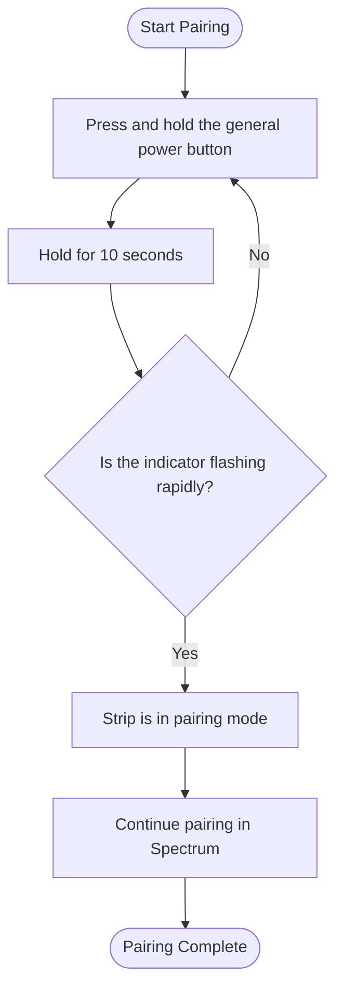

# Spectrum — Smart Power Management System

## Goal

Spectrum is an Android app that lets me control the LG U+ / Jinheung MTTL-W01 4-outlet smart power strip from my phone, because apparently turning things off manually was too mainstream.

But honestly, the power strip is only half the story.

I built this project to get my hands dirty with things I don't usually work with, explore different technologies, and get a taste of problems from different industries. From reverse-engineering hardware protocols to making sockets behave, the goal is to learn, experiment, and occasionally question my life choices.

## Main architecture of this smart strip

### 1. The Pairing Process 🔌

The most complicated part of this app is getting the Android phone to talk to the smart power strip in the first place.

1. **Enter pairing mode:** Press and hold the strip's general power button for **10 seconds**.
2. **Look for the signal:** The indicator next to the general power button should start flashing rapidly, meaning the strip is ready to be paired.
3. **We need to send two pieces of information to the strip:
    1. ***Your backend server ip address so that the strip can communicate with.
    2. *** Your home Wi-Fi credentials so that strip can join your home Wi-Fi.
4. **The Strip is now connected to your Home Wi-Fi Network and have backend IP address so it can communicate with.

