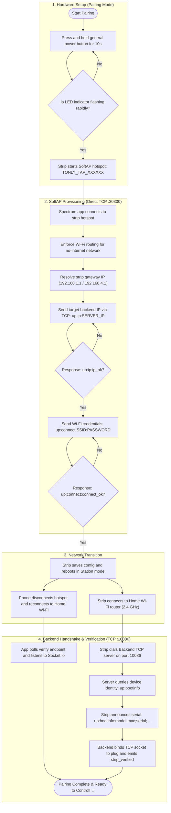

# Spectrum — Smart Power Management System

## Goal

Spectrum is an Android app that lets me control the LG U+ / Jinheung MTTL-W01 4-outlet smart power strip from my phone, because apparently turning things off manually was too mainstream.

But honestly, the power strip is only half the story.

I built this project to get my hands dirty with things I don't usually work with, explore different technologies, and get a taste of problems from different industries. From reverse-engineering hardware protocols to making sockets behave, the goal is to learn, experiment, and occasionally question my life choices.

## Main architecture of this smart strip

### 1. The Pairing Process 🔌

The most complicated part of this app is getting the Android phone to talk to the smart power strip in the first place.

1. **Enter pairing mode:** Press and hold the strip's general power button for **10 seconds**.
2. **Look for the signal:** The indicator next to the general power button should start flashing rapidly, indicating the strip is broadcasting its setup hotspot (`TONLY_TAP_XXXXXX`).
3. **Send configuration to the strip (via TCP port 30300):**
    1. **Backend Server IP:** Tells the strip where to connect for commands and telemetry (`up:ip:<SERVER_IP>`).
    2. **Home Wi-Fi Credentials:** Allows the strip to join your local network (`up:connect:<SSID>:<PASSWORD>`).
4. **Network switch & verification:**
    - The strip reboots into Station mode and joins your home Wi-Fi network (2.4 GHz).
    - The strip connects to the backend server on port **10086**, identifying itself via `up:bootinfo` and completing verification.

